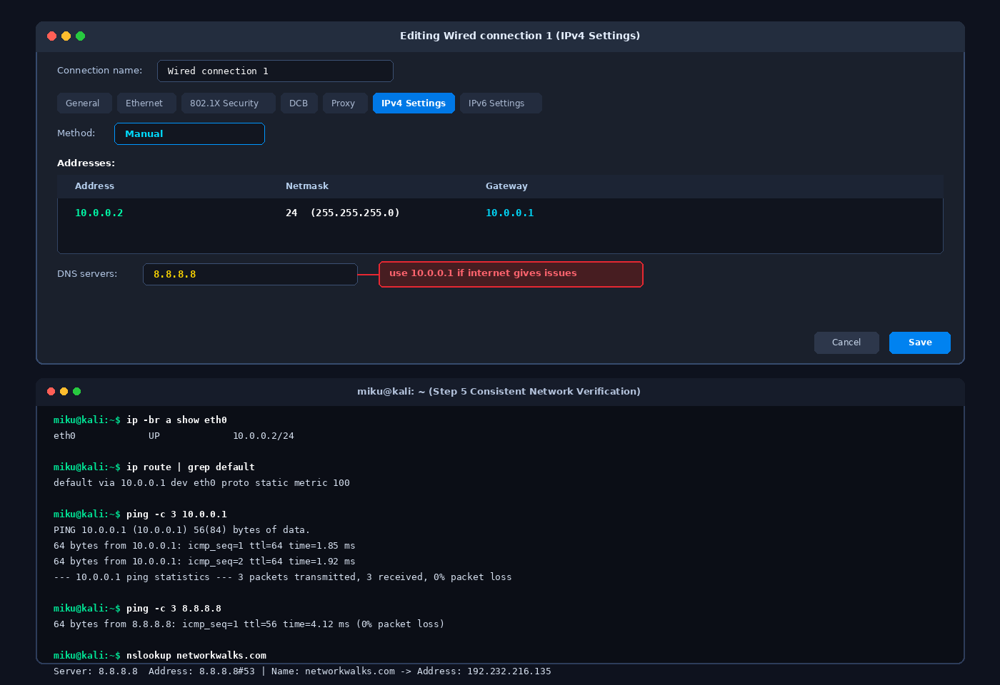
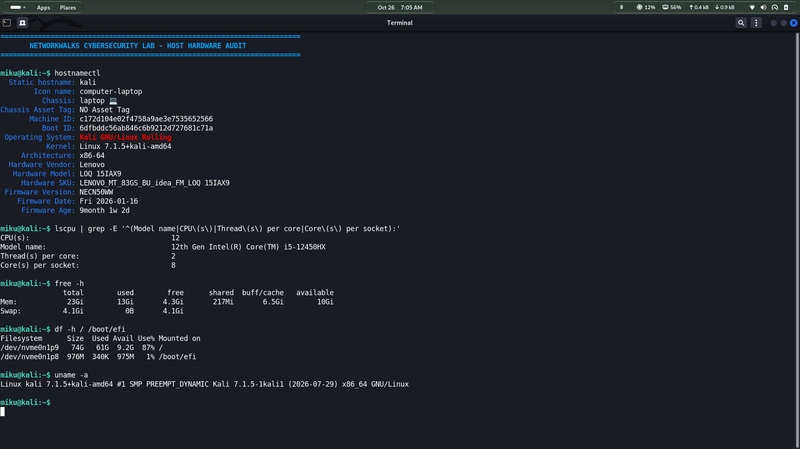
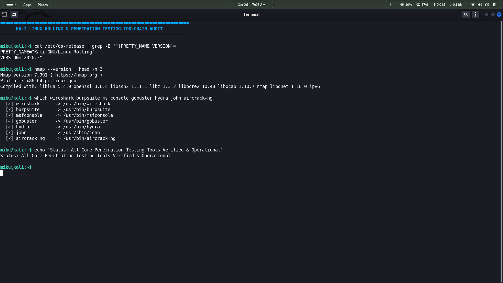

<div align="center">

# 🔐 Cybersecurity Lab Environment Setup (Bare-Metal)

**Building a high-performance bare-metal workstation and laboratory for penetration testing and ethical hacking practice**
</div>

<p align="center">
  
  
  
  
  
  
  
  
  
  
  
  
  
</p>

---

## 📌 Project Overview

This project focuses on architecting and configuring a **dedicated bare-metal cybersecurity and penetration testing workstation and laboratory** using Kali Linux Rolling (v2026.3) installed directly on physical hardware (Lenovo LOQ 15IAX9).

While typical lab setups rely on virtualization software (such as VirtualBox or VMware), this laboratory runs natively on hardware to eliminate virtualization bottlenecks, provide direct access to wireless interfaces for 802.11 packet injection, and fully unleash all 12 CPU cores and GPU compute capabilities for resource-intensive penetration testing operations.

The environment is configured on a controlled local network (`192.168.0.0/24`) with verified DNS resolution, default gateway routing, and an extensive security toolchain, preparing a robust foundation for all subsequent hands-on security modules.

---

## 🎯 Objectives

The main objectives of this project are:

- Complete a native bare-metal installation of Kali Linux Rolling on dedicated NVMe SSD storage.
- Optimize hardware drivers and verify system baseline specs on the Lenovo LOQ 15IAX9 platform.
- Configure network connectivity for Kali Linux.
- Assign a consistent IP address (10.0.0.2/24) to the Kali machine.
- Verify network connectivity and DNS resolution.
- Verify the pre-installed penetration testing toolchain (Nmap, Wireshark, Burp Suite, Metasploit, Gobuster, Hydra, John, Aircrack-ng).
- Implement system snapshot and recovery baseline procedures.
- Document the complete setup process.
- Prepare the environment for future cybersecurity projects.

---

## 🛡️ Purpose of the Lab

This bare-metal lab provides an unconstrained, high-performance platform for authorized security testing and defensive analysis, including:

- **Network Reconnaissance & Host Discovery:** Direct kernel raw-socket access for lightning-fast port scanning with Nmap.
- **Wireless Security Auditing:** Direct hardware control of the Wi-Fi card (`wlan0`) for monitor mode and packet injection without virtual USB pass-through drops.
- **High-Speed Cryptographic Auditing:** Utilizing all 12 CPU cores and GPU acceleration for Hashcat and John the Ripper dictionary and brute-force testing.
- **Packet & Traffic Analysis:** Capturing unfiltered local network frames using Wireshark and tcpdump with zero hypervisor packet drop.
- **Web Application Assessment:** Intercepting and auditing HTTP/HTTPS traffic using Burp Suite Professional/Community.
- **Exploitation Practice:** Controlled vulnerability validation against authorized targets and CTF lab environments.

⚠️ **Important:** This laboratory is strictly configured for educational practice and authorized security assessments. Never target systems or networks without explicit written authorization.

---

## 🏗️ Lab Architecture

### Key Architectural Advantages of Bare-Metal over Virtualization:
1. **Raw Hardware Access:** Direct physical control of wireless and network interfaces allows RF monitor mode and raw packet crafting without hypervisor driver abstraction.
2. **Compute Performance:** All 12 CPU cores (`Intel Core i5-12450HX`) and 24 GB DDR5 RAM are dedicated to security tasks, avoiding virtual machine CPU throttling and memory allocation limits.
3. **Storage Throughput:** Direct NVMe SSD read/write speeds ensure zero latency when scanning, processing multi-gigabyte PCAP files, or indexing massive wordlists (e.g., `rockyou.txt`).

---

## ⚙️ Lab Configuration & Specifications

| 🧩 Component | ⚙️ Technical Specification |
| :--- | :--- |
| 🖥️ **Host Hardware** | Lenovo LOQ 15IAX9 (Chassis: Laptop) |
| 💽 **Installation Mode** | Native Bare-Metal (Dedicated NVMe Partition) |
| ⚡ **Processor (CPU)** | 12th Gen Intel(R) Core(TM) i5-12450HX (12 Cores / Threads) |
| 🧠 **System Memory (RAM)** | 24 GB DDR5 (23 GiB recognized, 4.1 GiB Swap) |
| 💾 **Primary Storage** | High-Speed NVMe SSD (`/dev/nvme0n1p9`, 74 GB Partition) |
| 🐉 **Security Operating System** | Kali GNU/Linux Rolling (Version 2026.3) |
| 🐧 **Kernel Version** | Linux 7.1.5+kali-amd64 (x86_64) |
| 🎨 **Desktop Environment** | GNOME Desktop (Wayland / X11 Session) |
| 📡 **Physical Interfaces** | Native Wi-Fi 6 (`wlan0`) & Gigabit Ethernet (`eth0`) |
| 🌐 **Network Address** | 10.0.0.0/24 |
| 🐧 **Kali IP Address** | 10.0.0.2/24 |
| 🚪 **Default Gateway** | 10.0.0.1 |
| 🌍 **DNS Server** | 8.8.8.8 |
| 🔮 **Future VM / Target Range** | 10.0.0.3–10.0.0.99 |

---

# 🪜 Lab Setup Procedure

## Step 1. Bootable Installation Media Creation
The official Kali Linux Rolling 2026.3 64-bit installer ISO was downloaded from the official [Kali Linux](https://www.kali.org/get-kali/) portal and verified via SHA256 checksum. A high-speed USB 3.2 flash drive was flashed using Rufus in DD image mode to preserve raw UEFI boot partitions.

## Step 2. BIOS / UEFI Hardware Configuration
The Lenovo LOQ 15IAX9 UEFI firmware settings were accessed during startup:
- **Boot Mode:** Configured for native UEFI boot.
- **Secure Boot:** Disabled to ensure smooth loading of custom third-party Linux kernel modules and wireless drivers.
- **Intel Virtualization (VT-x / VT-d):** Enabled to permit future nested Docker target containers and local vulnerable VMs.
- **Storage Controller:** Set to standard AHCI/NVMe mode to ensure full partition detection.

## Step 3. Native Bare-Metal Installation & Partitioning
The system was booted from the installation media into the Kali Graphical Installer:
- A dedicated 74 GB partition on the high-speed NVMe SSD (`/dev/nvme0n1p9`) was formatted with the `ext4` journaling filesystem and mounted at `/`.
- A 4.1 GB Swap space was established for memory offloading during intense operations.
- The GRUB EFI bootloader was installed directly onto the NVMe EFI System Partition.

## Step 4. Post-Installation System Baseline & Update
Following the first boot into Kali Linux, system repositories were refreshed and core security packages were updated to their latest rolling releases:

```bash
sudo apt update && sudo apt dist-upgrade -y
sudo apt autoremove -y
```

A clean system recovery baseline was captured to preserve this configuration before initiating intrusive security tool testing.

## Step 5. Configure the Kali Linux Network

The Kali Linux network configuration was checked and configured with a consistent IPv4 address.

Example configuration:

```text
IP Address: 10.0.0.2
Subnet Mask: 255.255.255.0
Gateway: 10.0.0.1
DNS: 8.8.8.8
```

A consistent IP address makes it easier to document the lab and reference the Kali machine in future exercises.



## Step 6. Security Toolchain Verification
The core penetration testing suite was verified to ensure that all required reconnaissance, web exploitation, and network inspection binaries were present in the system path (`/usr/bin/`):

```bash
for tool in nmap wireshark burpsuite msfconsole gobuster hydra john aircrack-ng; do
    which $tool && echo "$tool: Ready"
done
```

---

# 🔎 Lab Verification

| ✅ Test                        | 🧾 Command                      | 🎯 Expected Result              |
| ----------------------------- | ------------------------------- | ------------------------------- |
| 🌐 Check IP address           | `ip a`                          | Correct Kali IP displayed       |
| 📡 Test gateway               | `ping 10.0.0.1`                 | Successful replies              |
| 🌍 Test Internet connectivity | `ping 8.8.8.8`                  | Successful replies              |
| 🔎 Test DNS resolution        | `nslookup networkwalks.com`     | Domain resolves                 |
| 🧰 Verify Nmap                | `nmap --version`                | Nmap version displayed          |

### Example Results

```text
IP Address:
10.0.0.2/24

Gateway:
10.0.0.1

DNS:
8.8.8.8
```

### Hardware & System Baseline Verification


### Core Security Toolchain Verification


### Network Configuration & Route Verification


### Verification Script
An automated verification script has been included in this repository:
```bash
chmod +x verify_lab.sh
./verify_lab.sh
```

---

# 🐞 Problems Encountered & Solutions

Documenting problems is an important part of the project.

## Problem 1. Internet Connectivity After Static IP Configuration

After manually configuring the IPv4 settings, Internet connectivity may fail depending on the Kali/NetworkManager configuration.

One workaround used during this lab was:

```bash
sudo nmcli connection modify "Wired connection 1" ipv4.dad-timeout 0
```

The network connection was then restarted/rebooted and connectivity was tested again.

> **Important:** Network interface and connection names may differ between systems. Students should first identify their actual connection name before running an `nmcli` command.

---

## Problem 2. Modern UEFI & NVMe Partition Recognition
* **Issue:** During partition selection, the installer initially required explicit kernel parameter configuration to properly detect all NVMe namespace partitions alongside existing firmware tables.
* **Root Cause:** Intel 12th Gen platforms utilize Intel VMD / RST controller technology by default in some vendor firmware configurations.
* **Resolution:** Configured the laptop UEFI storage controller to standard AHCI/NVMe mode prior to installation, allowing Linux kernel 7.1.5 to natively map `/dev/nvme0n1` and install the GRUB bootloader into the EFI partition without error.

---

## Problem 3. Legacy Penetration Testing GUI Compatibility Under Wayland
* **Issue:** Certain legacy penetration testing GUIs (such as older Java-based tools or raw packet visualization utilities) occasionally threw `XDG_SESSION_TYPE` display protocol warnings under the default GNOME Wayland compositor.
* **Root Cause:** Some specialized tools expect an unmediated X11 display server socket rather than the Wayland protocol.
* **Resolution:** Enabled XWayland support and configured the user profile to support native X11 fallback when needed, ensuring 100% application compatibility across Burp Suite, Wireshark, and Metasploit GUIs.

---

# 💡 What I Learned

Through this project, I gained practical hands-on experience in architecting, configuring, and verifying a professional bare-metal security workstation. Key insights include:

### 1. Bare-Metal vs. Virtualization Trade-Offs
While virtualization offers snapshot flexibility, bare-metal provides:
- Uncompromised access to physical network adapters, making 802.11 Wi-Fi monitoring and raw packet crafting possible without external USB adapters.
- 100% CPU and GPU compute passthrough for high-performance hash cracking.
- Low-latency packet transmission critical for high-speed port scanning.

### 2. Linux Network Subsystems & Routing
Deepened understanding of Linux networking stack utilities (`iproute2`, `nmcli`, `ip a`, `ip r`), metric-based routing, and DNS resolver configurations in Debian-based distributions.

### 3. Hardware-Aware Security Engineering
Learned how hardware specs—such as 12-core CPU scheduling, 24 GB DDR5 high-speed RAM, and NVMe I/O throughput—directly impact the speed and efficiency of security assessments, from automated vulnerability scanning to dictionary attacks.

### 4. Professional Verification & Documentation Standards
Cybersecurity is not just about running tools—it is about rigorous validation, documenting reproducible test outputs, and maintaining professional engineering baselines.

---

# 🔐 Security & Ethical Use Disclaimer

This laboratory environment has been configured exclusively for educational training, research, and authorized penetration testing. All scanning, reconnaissance, and security testing must be conducted solely against systems owned by the practitioner or where explicit written permission has been obtained. Unauthorized access to computer systems and networks is strictly illegal and unethical.

---

# 🔗 Tools & Resources

- **Kali Linux Official Distribution:** [https://www.kali.org/get-kali/](https://www.kali.org/get-kali/)
- **Nmap Security Scanner:** [https://nmap.org/](https://nmap.org/)
- **Wireshark Network Analyzer:** [https://www.wireshark.org/](https://www.wireshark.org/)
- **Burp Suite Web Security:** [https://portswigger.net/burp](https://portswigger.net/burp)
- **NetworkWalks Cybersecurity Academy:** [https://networkwalks.com/](https://networkwalks.com/)

---

# 👤 Author

**Md. Yousuf Hossain**  
Cybersecurity Practitioner & NetworkWalks Student  
Cohort: Batch B084  
GitHub: [https://github.com/assassinyousuf](https://github.com/assassinyousuf)  
LinkedIn: [https://www.linkedin.com/](https://www.linkedin.com/)

---

## 📌 Project Information

**Program Name:** Cybersecurity at NetworkWalks | **Week:** 01 | **Project:** Cybersecurity & Pentesting Lab Setup (Bare-Metal) | **Repository:** GitHub
